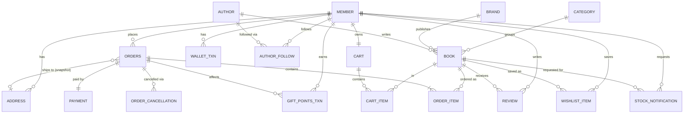
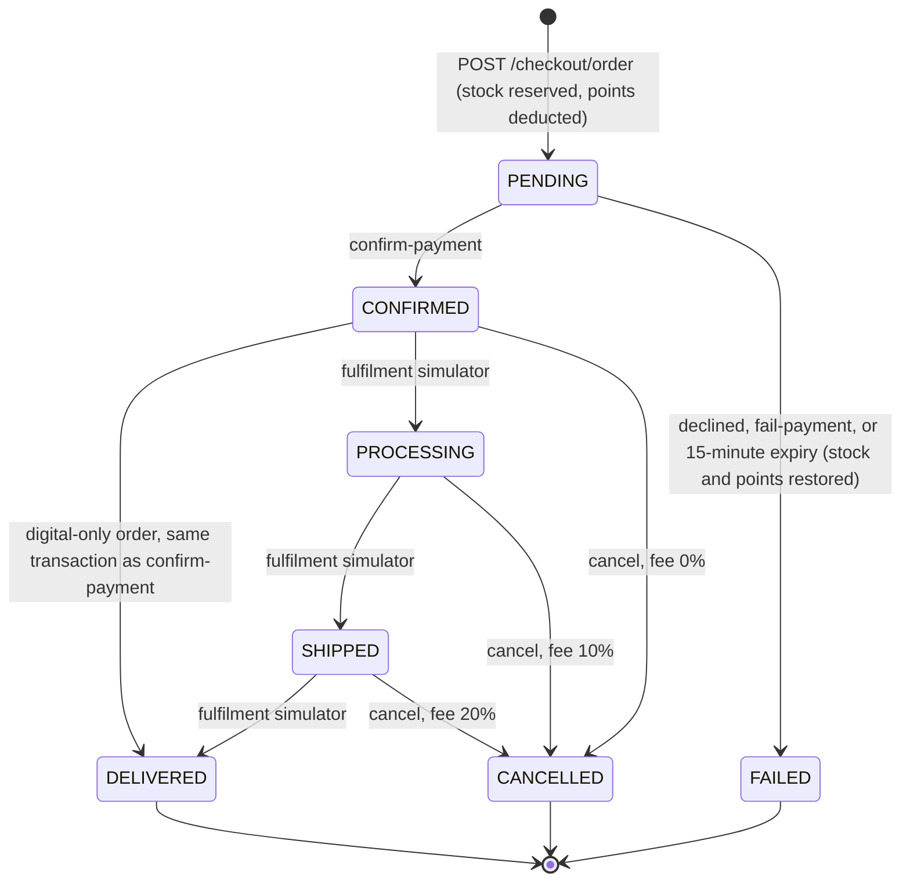

# Data Model: Book Haven

Database `books` (PostgreSQL), created by Flyway migrations. Package root
`com.bookhaven`, organised by domain: `member`, `catalog`, `cart`, `order`, `payment`, `shipping`.

Conventions: primary keys are UUIDs; money is `NUMERIC(12,2)` in INR; timestamps are `timestamptz`
read through an injected `Clock`; every table has `created_at`. Tier 2 items are marked **(T2)**.
Names follow the spec ("Member", "Writer" in the UI, `Author` in code).

## Enumerations

| Enum | Values |
|------|--------|
| `BookFormat` | `PAPERBACK`, `HARDCOVER`, `EBOOK`, `AUDIOBOOK` (physical = first two) |
| `AddressLabel` | `HOME`, `OFFICE`, `OTHER` |
| `OrderStatus` | `PENDING`, `CONFIRMED`, `PROCESSING`, `SHIPPED`, `DELIVERED`, `CANCELLED`, `FAILED` |
| `PaymentMethod` | `CREDIT_CARD`, `DEBIT_CARD`, `UPI`, `NET_BANKING`, `WALLET`, `COD` |
| `PaymentStatus` | `PENDING`, `SUCCESS`, `FAILED`, `REFUNDED` |
| `RefundMethod` | `WALLET`, `BANK` |
| `RefundStatus` | `PROCESSED`, `INITIATED` |
| `WalletTxnType` | `CREDIT`, `DEBIT` |

There is no `ADMIN` role and no `MOCK` payment method (admin is out of scope; the simulated
gateway is behaviour, not a method).

## member domain

### Member
| Field | Type | Rules |
|-------|------|-------|
| id | UUID | PK |
| fullName | varchar(100) | required, 2-100 chars |
| email | varchar(254) | required, unique (case-insensitive), valid format |
| passwordHash | varchar(100) | BCrypt; never returned |
| giftPoints | int | >= 0 |
| walletBalance | numeric(12,2) | >= 0 |
| createdAt | timestamptz | |

Validation: password 6-72 chars on input (72 is BCrypt's limit); error messages never say which of
email or password was wrong (FR-003).

### Address
`id`, `memberId` (FK), `label` (AddressLabel), `recipientName` (2-100), `phone` (10 digits),
`line1` (required, <=120), `line2`, `city`, `state`, `postalCode` (`^[1-9][0-9]{5}$`), `country`
(default `India`), `isDefault`, `deletedAt` (soft delete).
Rules: at most one default per member (partial unique index where `isDefault AND deletedAt IS NULL`);
the first address becomes the default; setting a new default clears the old one in the same
transaction; deleting the default leaves none selected (spec edge case); orders store an address
**snapshot** (copied fields) so editing or deleting an address never alters past orders.

### GiftPointsTransaction
`id`, `memberId`, `orderId?`, `points` (signed), `reason` (`REDEEMED`, `EARNED`, `RESTORED_ON_FAILURE`,
`RESTORED_ON_CANCEL`), `createdAt`. **(Listing is T2; writing is T1.)**

### WalletTransaction (T1 write for payment and refund, T2 for top-up and listing)
`id`, `memberId`, `type` (CREDIT/DEBIT), `amount` (> 0), `description`, `source` (`TOPUP`,
`ORDER_PAYMENT`, `ORDER_REFUND`), `createdAt`. Balance changes and the row are written in one
transaction; the member row is locked (`SELECT ... FOR UPDATE`) while changing the balance.

### WishlistItem (T2)
`id`, `memberId`, `bookId`, unique `(memberId, bookId)`.

### AuthorFollow (T2)
`id`, `memberId`, `authorId`, unique `(memberId, authorId)`.

### Library (T2; no table)
Derived: books with format `EBOOK` or `AUDIOBOOK` in the member's `CONFIRMED`+ order items.
Access to content, audio and download requires such an order item (FR-064).

## catalog domain

### Category
`id`, `name` (unique), `slug` (unique), `description`, `sortOrder`.

### Brand
`id`, `name` (unique), `slug` (unique), `logoUrl`. Shown on the product page as "Published by".

### Author
`id`, `name` (unique), `slug` (unique), `bio`, `imageUrl`.

### Book (table `book`)
| Field | Type | Rules |
|-------|------|-------|
| id | UUID | PK |
| title | varchar(200) | required |
| authorId, categoryId, brandId | FK | required |
| description | text | |
| isbn | varchar(20) | |
| price | numeric(12,2) | > 0 (list price) |
| discountPercent | numeric(5,2) | 0-90 |
| format | BookFormat | |
| language | varchar(20) | one of English, Hindi, Tamil, Telugu, Kannada |
| stockQuantity | int | >= 0; ignored for digital formats |
| coverImageUrl | varchar(300) | `/covers/<slug>.svg` |
| slug | varchar(120) | unique |
| rating | numeric(2,1), reviewCount int | recomputed when a review is added |
| baseSoldCount | int | seeded; sold count = base + units in confirmed orders |
| createdAt | timestamptz | "New Launches" sorts on this |

Derived and returned, never stored: `unitPrice = round(price x (1 - discountPercent/100), 2)`,
`inStock`, `deliveryDate` (shipping domain, from the member's pincode), `soldCount`.
Indexes: `(categoryId)`, `(authorId)`, `(format)`, `(language)`, GIN or `lower(title)` search index.

### Review (T2)
`id`, `memberId`, `bookId`, `rating` (1-5), `body` (<= 100 chars), `createdAt`,
unique `(memberId, bookId)`. Adding a review recalculates `rating` and `reviewCount` in the same
transaction. A member may review any book (verified-purchase is not required by the spec).

### StockNotification
`id`, `memberId`, `bookId`, unique `(memberId, bookId)`, `createdAt`. Created by Notify Me only when
the book is out of stock (FR-015). Sending a notification is out of scope.

## cart domain

### Cart
`id`, `memberId` (unique, one per member).

### CartItem
`id`, `cartId`, `bookId`, `quantity` (1-10 and <= stock for physical), unique `(cartId, bookId)`.
The unit price is **not** stored; the cart always prices from the current book, so the user sees
current values (spec edge case). Summary (server-calculated):
`subtotal`, `shippingAmount`, `freeShippingRemaining`, `total`, `pointsToEarn`, `hasPhysical`,
`hasDigital`, `itemCount`.

## order domain

### Order (table `orders`)
| Field | Type | Rules |
|-------|------|-------|
| id | UUID | PK |
| memberId | FK | |
| idempotencyKey | varchar(64) | unique with `memberId` |
| status | OrderStatus | see state machine |
| subtotal | numeric | sum of line totals |
| shippingAmount | numeric | 0 or 49 |
| giftPointsUsed | int | |
| discountAmount | numeric | `giftPointsUsed x 0.10` |
| totalAmount | numeric | `max(0, subtotal + shipping - discount)` (the payable amount) |
| pointsEarned | int | set at confirmation |
| address snapshot | columns | recipientName, phone, line1, line2, city, state, postalCode, country; null for digital-only |
| deliveryDate | date | calculated at order time |
| createdAt, confirmedAt, packedAt, shippedAt, deliveredAt, cancelledAt, expiresAt | timestamptz | `expiresAt = createdAt + 15 min` while `PENDING` |
| cancellationFee, refundAmount | numeric | running totals across partial cancels |

### OrderItem
`id`, `orderId`, `bookId`, `titleSnapshot`, `formatSnapshot`, `quantity` (>= 1),
`cancelledQuantity` (0..quantity), `unitPrice`, `lineTotal`.

### OrderCancellation (one row per cancel action)
`id`, `orderId`, `reason`, `note`, `itemsJson` (the lines cancelled), `valueCancelled`,
`discountShare`, `grossPaid`, `feeRate`, `feeAmount`, `refundAmount`, `pointsRestored`,
`refundMethod`, `refundStatus`, `refundDestination` (masked), `createdAt`.

### State machine

A partial cancellation leaves the status unchanged; the order becomes `CANCELLED` only when no
physical quantity remains.

## payment domain

### Payment
`id`, `orderId` (unique), `method`, `status`, `amount`, `reference` (generated), `createdAt`.
Card numbers, CVV, UPI IDs and bank selections beyond a method name are **never stored**.

## shipping domain (no tables)

`DeliveryEstimator` and `ShippingCalculator` hold the rules; configuration is in
`application.properties` (cut-off hour, handling days, transit days, metro prefixes, free threshold
500, flat charge 49).

## Business rules (calculation reference)

| Rule | Formula or behaviour | Spec |
|------|----------------------|------|
| Unit price | `round(price x (1 - discountPercent / 100), 2)` | FR-032 |
| Shipping | `0` if no physical item or `subtotal >= 500`, else `49`; mixed carts count only physical lines toward the threshold | FR-033 |
| Points discount | `points x 0.10`; points are capped at the member's balance and at `subtotal + shipping` | FR-045 |
| Payable | `max(0, subtotal + shipping - discount)` | FR-032 |
| Points earned | `floor(payable / 10)`, returned by the server at confirmation | FR-046, FR-047 |
| Cancel window | open while `now < createdAt + 48h`; closed at exactly 48 hours; tested before any fee | FR-053 |
| Cancel fee | `valueCancelled x rate`; rate 0 (`CONFIRMED`), 0.10 (`PROCESSING`), 0.20 (`SHIPPED`) | FR-055 |
| Discount share | `discountAmount x valueCancelled / subtotal` | FR-054 |
| Refund | `max(0, valueCancelled - discountShare - fee)`; shipping is not refunded (baseline behaviour) | FR-054, FR-056 |
| Points restored | `round(giftPointsUsed x valueCancelled / subtotal)` | FR-057 |
| Cancellable items | physical formats only, by item and quantity | FR-058 |
| Refund destination | wallet: `PROCESSED` and credited at once; bank: `INITIATED`, details validated (holder 2+ chars, account 9-18 digits, IFSC `^[A-Z]{4}0[A-Z0-9]{6}$`), account number stored masked as `XXXXXX1234` | FR-056 |
| Pending expiry | unpaid after 15 minutes: `FAILED`, stock and points restored | FR-046a |

## Seed data (Flyway `V2__seed_catalog.sql`)

19 categories, about 6 brands, about 24 authors, about 36 books spanning every format and language,
with a few out-of-stock titles and some discounted. Fixed slugs make re-running safe. No members,
passwords, orders or reviews are seeded in any profile except the optional dev demo member.
